# Hi there, I'm Baji Yadav 👋

  <strong>Full-Stack, Mobile & AI Systems Engineer specializing in high-throughput cloud backends, production Flutter apps, enterprise SaaS, and autonomous intelligence architectures.</strong>

  
  
  
  

  
  
  
  

<!-- Quick Navigation Anchors -->

  <a href="#-technical-arsenal"><b>🛠️ Tech Arsenal</b></a> •
  <a href="#-project-ecosystem-graph"><b>🌐 Ecosystem Graph</b></a> •
  <a href="#-flagship--high-impact-systems"><b>🏆 Flagship Systems</b></a> •
  <a href="#-enterprise-saas-fintech--b2b-platforms"><b>🏢 Enterprise SaaS</b></a> •
  <a href="#-security-computer-vision--cryptography"><b>🛡️ Security & AI</b></a> •
  <a href="#-master-project-directory"><b>📋 All Projects Index</b></a> •
  <a href="#-github-activity-contribution-graph--analytics"><b>📊 Analytics</b></a>

<!-- Interactive Skill Icons Strip -->

  

---

### 🚀 About Me

- 🌍 Architecting **[ClimateChain AI](https://github.com/Bajiyadav/climatechain-ai)** — an autonomous climate intelligence engine uniting **Isolation Forest ML Oracles** with **ERC-1155 Smart Contracts** for zero double-counting carbon credit verification and P2P microgrid energy trading (IEEE ClimateChain Global Hackathon 2026).
- 🔭 Engineering **[Seedha Properties](https://github.com/Bajiyadav/property-pioneer-dev)** — a zero-brokerage PropTech ecosystem built with React 19 / TanStack Start, production Flutter iOS & Android apps, and an enterprise Java 21 Spring Boot 3 backend on Google Cloud Run with Cloud SQL (PostGIS 3.4).
- 🤖 Building **[AuditAgent.ai](https://github.com/Bajiyadav/Agentic.Ai)** & **[PayPal AI Agent](https://github.com/Bajiyadav/paypal-ai-agent)** — specialized autonomous agents for technical hiring screening and conversational financial transaction processing.
- 📱 Developing fluid, native-performance mobile applications with **Flutter & Dart**, featuring Riverpod/BLoC state management, reactive offline caching, and clean DDD architecture.
- ⚡ Focused on **high throughput, sub-second latency, REST & GraphQL API design, spatial indexing, and OWASP Top 10 security hardening**.
- ☁️ Production cloud experience with **Google Cloud Platform (Cloud Run, Cloud SQL, Memorystore Redis, GCS)**, **Docker**, and **GitHub Actions CI/CD**.
- 🎓 Pursuing Bachelor of Technology (B.Tech) in **Computer Science & Engineering** at **GD Goenka University (2023–2027)**.

---

### 🛠️ Technical Arsenal

```mermaid
flowchart TD
    TA["🛠️ <b>TECHNICAL ARSENAL</b><br/><i>Core Engineering & Systems Competencies</i>"]

    TA --> L["🔤 <b>Languages & Core</b>"]
    TA --> FM["📱 <b>Frontend & Mobile</b>"]
    TA --> BC["⚙️ <b>Backend, Cloud & Web3</b>"]
    TA --> DA["🧠 <b>Data, AI & Reliability</b>"]

    L --> L1["TypeScript & JavaScript (ESNext)"]
    L --> L2["Dart (Flutter Engine)"]
    L --> L3["Java 21 (LTS) & Python 3.12+"]
    L --> L4["Solidity (EVM / ERC-1155)"]

    FM --> FM1["React 19 & Next.js 15 (SSR / App Router)"]
    FM --> FM2["Flutter (Riverpod / BLoC Multiplatform)"]
    FM --> FM3["TanStack Start, Router & Query"]
    FM --> FM4["Tailwind CSS v4 & Lucide Icons"]

    BC --> BC1["Spring Boot 3 Microservices"]
    BC --> BC2["FastAPI Async REST & Node.js Express"]
    BC --> BC3["Google Cloud Platform (Cloud Run, Cloud SQL)"]
    BC --> BC4["Docker Containers & GitHub Actions CI/CD"]

    DA --> DA1["PostgreSQL 16 & PostGIS 3.4 Spatial"]
    DA --> DA2["Redis In-Memory Caching & Prisma ORM"]
    DA --> DA3["Google Gemini 2.5 Flash & Scikit-Learn ML"]
    DA --> DA4["OWASP Top 10 Hardening & Pytest / JUnit 5"]

    classDef header fill:#0284c7,stroke:#38bdf8,stroke-width:2px,color:#ffffff;
    classDef category fill:#0f172a,stroke:#38bdf8,stroke-width:1.5px,color:#38bdf8;
    classDef leaf fill:#1e293b,stroke:#475569,stroke-width:1px,color:#e2e8f0;

    class TA header;
    class L,FM,BC,DA category;
    class L1,L2,L3,L4,FM1,FM2,FM3,FM4,BC1,BC2,BC3,BC4,DA1,DA2,DA3,DA4 leaf;
```

<table>
  <tr>
    <td width="50%" valign="top">
      <h4>🔤 Languages & Core Engine</h4>
      

        
      

      <ul>
        <li><strong>TypeScript / JavaScript</strong>: Advanced async patterns, type-safety, ESNext.</li>
        <li><strong>Dart & Flutter</strong>: Native iOS & Android compilation, custom render objects.</li>
        <li><strong>Java 21 & Python</strong>: Enterprise microservices, ML pipelines, virtual threads.</li>
        <li><strong>Solidity</strong>: ERC-1155 multi-token contracts, atomic escrows & burn locks.</li>
      </ul>
    </td>
    <td width="50%" valign="top">
      <h4>📱 Frontend & Mobile Engineering</h4>
      

        
      

      <ul>
        <li><strong>React 19 & Next.js 15</strong>: Server actions, streaming SSR, edge rendering.</li>
        <li><strong>Flutter</strong>: Clean architecture with Riverpod & BLoC state management.</li>
        <li><strong>TanStack Ecosystem</strong>: TanStack Start, Router, Table, and Query.</li>
        <li><strong>Tailwind CSS v4 & Vite</strong>: High-aesthetic modern UI & sub-second HMR.</li>
      </ul>
    </td>
  </tr>
  <tr>
    <td width="50%" valign="top">
      <h4>⚙️ Backend, Cloud & Distributed Systems</h4>
      

        
      

      <ul>
        <li><strong>Spring Boot 3 & Java 21</strong>: Enterprise DDD architectures, JPA/Hibernate.</li>
        <li><strong>FastAPI & Node.js</strong>: High-throughput async REST microservices.</li>
        <li><strong>Google Cloud Platform</strong>: Cloud Run, Cloud SQL, Memorystore Redis, GCS.</li>
        <li><strong>DevOps</strong>: Docker containerization, multi-stage builds, GitHub Actions.</li>
      </ul>
    </td>
    <td width="50%" valign="top">
      <h4>🧠 Data, AI & Quality Engineering</h4>
      

        
      

      <ul>
        <li><strong>PostgreSQL 16 & PostGIS 3.4</strong>: Geo-spatial queries, spatial indexing.</li>
        <li><strong>Redis & Prisma ORM</strong>: In-memory distributed caching, type-safe queries.</li>
        <li><strong>AI & ML</strong>: Google Gemini 2.5 Flash, Scikit-Learn Isolation Forest, OpenCV.</li>
        <li><strong>Testing & Security</strong>: Vitest, JUnit 5, Pytest, Postman, OWASP Top 10 hardening.</li>
      </ul>
    </td>
  </tr>
</table>

---

### 🌐 Project Ecosystem Graph

```mermaid
flowchart TD
    BY["👨‍💻 <b>BAJI YADAV PORTFOLIO ECOSYSTEM</b><br/><i>20+ Full-Stack, Mobile, AI Agents & Cloud Deployments</i>"]

    BY --> D1["🌍 <b>AI Agents & Web3</b>"]
    BY --> D2["🏡 <b>PropTech & Mobile</b>"]
    BY --> D3["🏢 <b>Enterprise SaaS & B2B</b>"]
    BY --> D4["🛡️ <b>Security & Biometrics</b>"]
    BY --> D5["🎓 <b>EdTech & Utilities</b>"]

    D1 --> P1["<b>ClimateChain AI</b><br/>FastAPI • Solidity • IsolationForest • Gemini 2.5"]
    D1 --> P2["<b>AuditAgent.ai</b><br/>Autonomous AI Technical Hiring Screener"]
    D1 --> P3["<b>PayPal AI Agent</b><br/>Conversational Payment & Checkout Agent"]

    D2 --> P4["<b>Seedha Properties</b><br/>Flutter iOS/Android • Java 21 Spring • PostGIS"]
    D2 --> P5["<b>Digital Portfolio</b><br/>React 19 • TanStack Router • Tailwind v4"]

    D3 --> P6["<b>Extrute Enterprise</b><br/>Next.js • Razorpay • Prisma • PostgreSQL"]
    D3 --> P7["<b>Shree Gopi Traders</b><br/>B2B Procurement • Neon Postgres • Next.js 15"]
    D3 --> P8["<b>Quantum Edge Solutions</b><br/>Client Marketplace & Workflow Engine"]
    D3 --> P9["<b>Screenplay Theatres</b><br/>Private Cinema Booking & Seat Allocation"]
    D3 --> P10["<b>Trippy's Mehfill</b><br/>Event Management & Hospitality Portal"]

    D4 --> P11["<b>Fingerprint Biometrics</b><br/>Python 3 • OpenCV Ridge/Minutiae Extraction"]
    D4 --> P12["<b>Steganography Suite</b><br/>XOR + LSB Image Steganography GUI"]
    D4 --> P13["<b>Attack Canvas Central</b><br/>Visual Threat Modeling & SecOps Canvas"]
    D4 --> P14["<b>Srikanth Safety Portal</b><br/>Industrial Compliance & Consultancy Platform"]

    D5 --> P15["<b>FuturePath</b><br/>Career Guidance & Skill Roadmapping Engine"]
    D5 --> P16["<b>Tech League 2026</b><br/>Hackathon & Competitive Coding Platform"]
    D5 --> P17["<b>GDGU VCS Portal</b><br/>Developer Society & Version Control Hub"]
    D5 --> P18["<b>House of Bakers & Cake Land</b><br/>Confectionery E-Commerce Storefronts"]
    D5 --> P19["<b>Student Information System</b><br/>Python & SQL Academic Record System"]

    classDef root fill:#0284c7,stroke:#38bdf8,stroke-width:2px,color:#ffffff;
    classDef domain fill:#0f172a,stroke:#38bdf8,stroke-width:1.5px,color:#38bdf8;
    classDef project fill:#1e293b,stroke:#475569,stroke-width:1px,color:#e2e8f0;

    class BY root;
    class D1,D2,D3,D4,D5 domain;
    class P1,P2,P3,P4,P5,P6,P7,P8,P9,P10,P11,P12,P13,P14,P15,P16,P17,P18,P19 project;
```

---

### 🏆 Flagship & High-Impact Systems

<table>
  <tr>
    <td width="50%" valign="top">
      <h4>🌍 <a href="https://github.com/Bajiyadav/climatechain-ai">ClimateChain AI</a> IEEE Global Hackathon 2026</h4>
      
Autonomous Decentralized Carbon MRV Oracle & P2P Renewable Energy Trading Microgrid.

      

        
        
        
        
      

      <ul>
        <li><strong>AI MRV Cyber-Shield</strong>: Isolation Forest anomaly detector intercepting sensor spoofing & fraudulent solar claims prior to minting.</li>
        <li><strong>Zero Double-Counting</strong>: Non-reversible ERC-1155 burn state machine preventing duplicate retirements under Paris Agreement Art. 6.</li>
        <li><strong>P2P Microgrid AMM</strong>: Automated market-clearing tariff balancing solar surplus with 34.4% consumer energy savings.</li>
      </ul>
      

        
        
      

    </td>
    <td width="50%" valign="top">
      <h4>🏡 <a href="https://github.com/Bajiyadav/property-pioneer-dev">Seedha Properties</a> PropTech Ecosystem</h4>
      
Zero-brokerage real estate platform connecting buyers and tenants directly with property owners.

      

        
        
        
        
      

      <ul>
        <li><strong>Multiplatform Mobile</strong>: Production Flutter app for Android (.aab) & iOS (.ipa) with Riverpod, reactive caching, and 170+ automated tests.</li>
        <li><strong>Spatial Web App</strong>: TanStack Start SSR with MapLibre OSM privacy-jittered coordinates.</li>
        <li><strong>Enterprise Backend</strong>: Java 21 Spring Boot 3 DDD architecture deployed on Google Cloud Run with PostGIS spatial bounding queries.</li>
      </ul>
      

        
        
      

    </td>
  </tr>
  <tr>
    <td width="50%" valign="top">
      <h4>🤖 <a href="https://github.com/Bajiyadav/Agentic.Ai">AuditAgent.ai</a> Enterprise AI Agent</h4>
      
Autonomous AI Technical Hiring & Candidate Code Evidence Screening Platform.

      

        
        
        
        
      

      <ul>
        <li><strong>Code Evidence Verification</strong>: Evaluates repository quality, architecture adherence, and real contributor authentic patterns.</li>
        <li><strong>Automated Candidate Auditing</strong>: Generates deep technical assessments and interview cheat-sheets for engineering managers.</li>
      </ul>
      

        
        
      

    </td>
    <td width="50%" valign="top">
      <h4>💳 <a href="https://github.com/Bajiyadav/paypal-ai-agent">PayPal AI Agent & FinTech Bot</a></h4>
      
Conversational payment intelligence engine for automated transaction workflows and checkout queries.

      

        
        
        
      

      <ul>
        <li><strong>Smart Transaction Assistant</strong>: Parses conversational natural language into secure structured payment intents.</li>
        <li><strong>Webhooks & Status Audits</strong>: Real-time verification of payment settlement state transitions.</li>
      </ul>
      

        
        
      

    </td>
  </tr>
</table>

---

### 🏢 Enterprise SaaS, FinTech & B2B Platforms

<table>
  <tr>
    <td width="50%" valign="top">
      <h4>🚀 <a href="https://github.com/Bajiyadav/extrute">Extrute Enterprise Platform</a></h4>
      
Official commercial website & career platform for Extrute with dynamic job applications and payment gateways.

      

        
        
        
        
      

      <ul>
        <li>Auth.js authentication and role-based administration dashboard.</li>
        <li>Razorpay integration for transaction handling & Cloudinary asset optimization.</li>
      </ul>
      

        
        
      

    </td>
    <td width="50%" valign="top">
      <h4>💈 <a href="https://github.com/Bajiyadav/shree-gopi-traders">Shree Gopi Traders (B2B)</a></h4>
      
B2B salon and parlour supply procurement portal with inventory management and bulk dispatch tracking.

      

        
        
        
        
      

      <ul>
        <li>Wholesale catalog browsing with dynamic multi-tier volume pricing.</li>
        <li>Serverless Neon PostgreSQL integration with instant connection pooling.</li>
      </ul>
      

        
        
      

    </td>
  </tr>
  <tr>
    <td width="50%" valign="top">
      <h4>⚡ <a href="https://quantum-edge-solutions.vercel.app">Quantum Edge Solutions</a></h4>
      
Enterprise service marketplace platform with automated onboarding workflows and administrative dashboards.

      

        
        
        
      

      

        
        
      

    </td>
    <td width="50%" valign="top">
      <h4>🎬 <a href="https://github.com/Bajiyadav/screenplay-private-theatres">Screenplay Private Theatres</a></h4>
      
Luxury private theater experience booking engine with slot reservation, dynamic pricing, and preview showcase.

      

        
        
        
      

      

        
      

    </td>
  </tr>
  <tr>
    <td width="50%" valign="top">
      <h4>💼 <a href="https://baji-builds-digital-art.vercel.app">Digital Engineering Portfolio</a></h4>
      
Interactive personal portfolio with full-viewport workstation background, photo showcase, and live client inquiry flows.

      

        
        
        
      

      

        
      

    </td>
    <td width="50%" valign="top">
      <h4>🎪 <a href="https://github.com/Bajiyadav/trippysmehfill1">Trippy's Mehfill Platform</a></h4>
      
Curated social experiences, private event scheduling, and community gathering ticketing platform.

      

        
        
        
      

      

        
      

    </td>
  </tr>
</table>

---

### 🛡️ Security, Computer Vision & Cryptography

<table>
  <tr>
    <td width="50%" valign="top">
      <h4>🛡️ <a href="https://github.com/Bajiyadav/Finger-print">Fingerprint Biometric Recognition</a></h4>
      
Biometric authentication engine utilizing computer vision for ridge extraction and minutiae matching.

      

        
        
        
      

      <ul>
        <li>Gabor filtering and orientation field estimation.</li>
        <li>Crossing number minutiae extraction algorithm (ridge bifurcation & endings).</li>
      </ul>
      

        
      

    </td>
    <td width="50%" valign="top">
      <h4>🔐 <a href="https://github.com/Bajiyadav/stegno">Steganography Cryptography Suite</a></h4>
      
Python desktop application for covert message embedding inside images using XOR and LSB bit manipulation.

      

        
        
        
      

      <ul>
        <li>XOR key-based payload scrambling combined with Least Significant Bit injection.</li>
        <li>Lossless extraction preserving host carrier image visual fidelity.</li>
      </ul>
      

        
      

    </td>
  </tr>
  <tr>
    <td width="50%" valign="top">
      <h4>🎯 <a href="https://github.com/Bajiyadav/attack-canvas-central">Attack Canvas Central</a></h4>
      
Interactive threat modeling and visual cybersecurity attack graph simulation platform.

      

        
        
        
      

      

        
      

    </td>
    <td width="50%" valign="top">
      <h4>🦺 <a href="https://srikanth-safety.vercel.app/">Srikanth Safety Platform</a></h4>
      
Corporate industrial safety training and environmental consultancy portal for industrial client onboarding.

      

        
        
      

      

        
        
      

    </td>
  </tr>
</table>

---

### 📋 Master Project Directory

*A comprehensive catalogue of all production platforms, research prototypes, and open-source software engineered by Baji Yadav:*

| 🚀 Project | 🏷️ Domain | 🛠️ Tech Stack | 💡 Core Innovation / Capability | 🔗 Links |
| :--- | :--- | :--- | :--- | :---: |
| **[ClimateChain AI](https://github.com/Bajiyadav/climatechain-ai)** | Web3 & AI | `FastAPI` `Solidity ERC-1155` `Scikit-Learn` `Gemini 2.5` | Zero double-counting carbon oracle + P2P solar trading microgrid (IEEE 2026) | [Repo](https://github.com/Bajiyadav/climatechain-ai) |
| **[Seedha Properties](https://github.com/Bajiyadav/property-pioneer-dev)** | PropTech & Mobile | `Flutter` `Java 21 Spring Boot 3` `React 19` `PostGIS 3.4` | Zero-brokerage real estate platform with spatial bounding & native iOS/Android apps | [Repo](https://github.com/Bajiyadav/property-pioneer-dev) |
| **[AuditAgent.ai](https://github.com/Bajiyadav/Agentic.Ai)** | AI Agents | `Python` `AI Agents` `Docker` `JavaScript` | Autonomous technical hiring screener verifying candidate code evidence | [Repo](https://github.com/Bajiyadav/Agentic.Ai) |
| **[PayPal AI Agent](https://github.com/Bajiyadav/paypal-ai-agent)** | FinTech & AI | `Python` `PayPal API` `JavaScript` `REST` | Conversational payment intent parsing & automated checkout intelligence | [Repo](https://github.com/Bajiyadav/paypal-ai-agent) |
| **[Extrute Platform](https://github.com/Bajiyadav/extrute)** | Enterprise SaaS | `Next.js` `Prisma` `PostgreSQL` `Razorpay` `Auth.js` | Official corporate career platform with payments & Cloudinary media pipeline | [Repo](https://github.com/Bajiyadav/extrute) |
| **[Shree Gopi Traders](https://github.com/Bajiyadav/shree-gopi-traders)** | B2B Marketplace | `Next.js 15` `Prisma` `Neon PostgreSQL` `Tailwind` | B2B salon & parlour procurement system with tiered wholesale catalog | [Repo](https://github.com/Bajiyadav/shree-gopi-traders) |
| **[Quantum Edge Solutions](https://github.com/Bajiyadav/quantum-edge-solutions)** | SaaS & Workflow | `Next.js` `TypeScript` `Prisma` `PostgreSQL` | Enterprise client onboarding & service request management engine | [Live](https://quantum-edge-solutions.vercel.app) • [Repo](https://github.com/Bajiyadav/quantum-edge-solutions) |
| **[Digital Portfolio](https://github.com/Bajiyadav/baji-builds-digital-art)** | Web Architecture | `React 19` `TanStack Router` `Tailwind v4` `Vercel` | High-aesthetic personal engineering showcase with photo showcase & client inquiry | [Live](https://baji-builds-digital-art.vercel.app) • [Repo](https://github.com/Bajiyadav/baji-builds-digital-art) |
| **[Screenplay Theatres](https://github.com/Bajiyadav/screenplay-private-theatres)** | Leisure Tech | `Next.js` `TypeScript` `Tailwind CSS` | Luxury private theater slot scheduling, dynamic pricing & trailer previews | [Repo](https://github.com/Bajiyadav/screenplay-private-theatres) |
| **[Trippy's Mehfill](https://github.com/Bajiyadav/trippysmehfill1)** | Hospitality Tech | `Next.js` `TypeScript` `Tailwind CSS` | Experience ticketing platform for private events & intimate social gatherings | [Repo](https://github.com/Bajiyadav/trippysmehfill1) |
| **[Fingerprint Biometrics](https://github.com/Bajiyadav/Finger-print)** | Computer Vision | `Python 3` `OpenCV` `NumPy` | Automated fingerprint ridge extraction & minutiae point matching algorithms | [Repo](https://github.com/Bajiyadav/Finger-print) |
| **[Steganography Suite](https://github.com/Bajiyadav/stegno)** | Cybersecurity | `Python 3` `Tkinter` `Cryptography` `XOR + LSB` | Covert message embedding in bitmap carriers with dual-layer bit obfuscation | [Repo](https://github.com/Bajiyadav/stegno) |
| **[Attack Canvas Central](https://github.com/Bajiyadav/attack-canvas-central)** | SecOps | `TypeScript` `Python` `SecOps` | Threat graph modeling & security canvas visualization tool | [Repo](https://github.com/Bajiyadav/attack-canvas-central) |
| **[Srikanth Safety Portal](https://github.com/Bajiyadav/srikanth-safety-is)** | EdTech & Safety | `Next.js` `TypeScript` `Tailwind CSS` | Corporate industrial safety compliance, training, and client management | [Live](https://srikanth-safety.vercel.app/) • [Repo](https://github.com/Bajiyadav/srikanth-safety-is) |
| **[FuturePath](https://github.com/Bajiyadav/FuturePath-)** | EdTech | `TypeScript` `React` `CSS Modules` | Interactive career roadmapping & curriculum recommendation portal | [Repo](https://github.com/Bajiyadav/FuturePath-) |
| **[Tech League 2026](https://github.com/Bajiyadav/tech-league-2026)** | EdTech | `JavaScript` `HTML5` `CSS3` | Competitive programming event registration & leaderboard portal | [Repo](https://github.com/Bajiyadav/tech-league-2026) |
| **[VCS GDGU Portal](https://github.com/Bajiyadav/VCS---GDGU)** | Developer Tools | `JavaScript` `CSS` `Web` | GD Goenka University version control society portal & student dev hub | [Repo](https://github.com/Bajiyadav/VCS---GDGU) |
| **[House of Bakers & Cake Land](https://github.com/Bajiyadav/House-Of-Bakers)** | E-Commerce | `Next.js` `React` `Tailwind CSS` | Confectionery and bakery digital ordering storefront with responsive UI | [Live](https://houseofbaker.vercel.app/) • [Repo](https://github.com/Bajiyadav/House-Of-Bakers) |
| **[Student Information System](https://github.com/Bajiyadav/student-information-system)** | Academic Tools | `Python 3` `SQL / File I/O` | Academic grading, attendance tracking, and student record management system | [Repo](https://github.com/Bajiyadav/student-information-system) |
| **[Electricity Billing Engine](https://github.com/Bajiyadav/Electricity_bill)** | Utilities | `Python / Logic` `Algorithms` | Dynamic unit consumption tiered tariff calculation utility | [Repo](https://github.com/Bajiyadav/Electricity_bill) |

---

### 📊 GitHub Activity, Contribution Graph & Analytics

<!-- 1. Contribution Timeline & Activity Graph -->

  

 

<!-- 2. Repositories and Most Committed Languages -->

  
  

 

<!-- 3. Overall Stats & Streak Performance -->

  
  

---

  Engineered with precision & passion by <strong>Baji Yadav</strong>. Open to exciting full-stack, mobile engineering, and Web3/AI opportunities.

